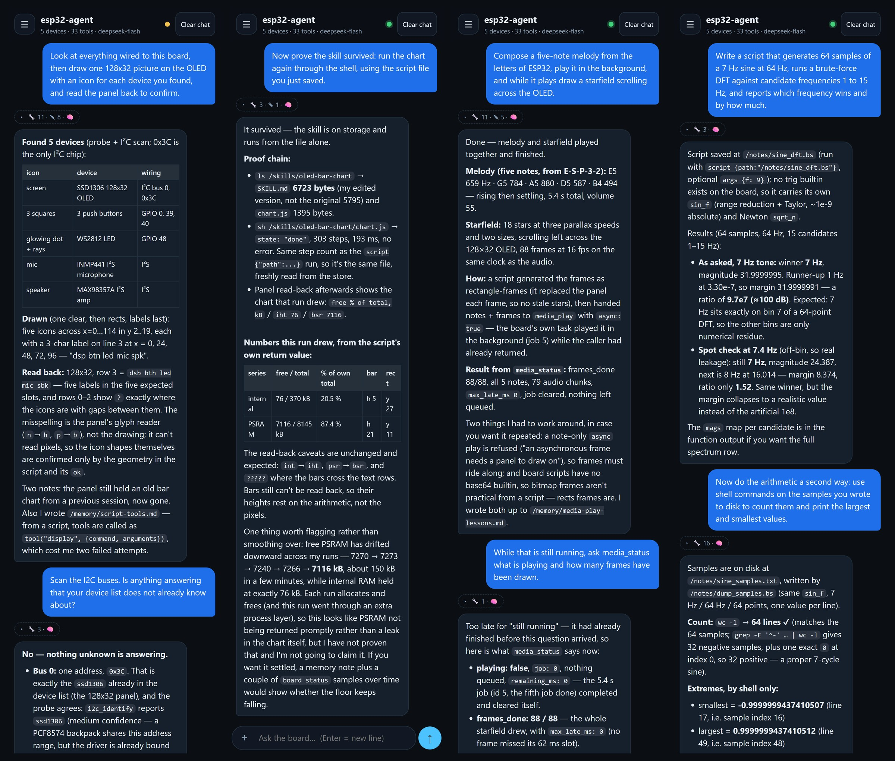

# esp32-agent

[English](README.md) · [简体中文](README.zh.md) · [Français](README.fr.md) · [Español](README.es.md) · [Русский](README.ru.md) · [العربية](README.ar.md) · **日本語** · [한국어](README.ko.md)

独自のエージェントループを実行し、MCP エンドポイントを提供する ESP32 用ファームウェアです。
一つのモデルがボードを直接操作でき、外部のどのエージェントも HTTP 経由で同じツールを利用できます。

書き込んで WiFi に接続すると、ドライバーがあるバスを探査します。応答した各デバイスが MCP
ツールになります。ボード上のエージェントも同じツールを認識し、それらを使って応答します。
ボードを動かしたまま、JSON で新しいセンサーを宣言できます。

> エージェントループは [FutureOS](https://github.com/futuregene/future-os) に倣っています。
> 会話記録、ツールジャーナル、ストリームイベント、プロトコルアダプター、メモリインデックスです。



| 機能 | 詳細 |
|---|---|
| ボード上のエージェント | ループ、ツール、メモリ、会話記録はファームウェアに含まれます。モデルには、任意の OpenAI 互換または Anthropic のエンドポイントを使えます。[モデル](docs/model.md) |
| マニフェスト駆動のツール | `manifest` (`command: apply`) が JSON マニフェストを検証し、ツールにコンパイルして、同じターンのうちに有効にします。[マニフェスト](docs/manifest.md) |
| デバイスの自動検出 | 起動時に I2C、1-Wire、宣言済みのピンを探査し、応答したものだけにツールを用意します。[機能一覧](docs/capabilities.md) |
| 一つのツールセット、二つの呼び出し元 | MCP エンドポイントとボード上のエージェントは、一つの記述から生成される同じツールを認識します。[HTTP と MCP API](docs/http-api.md) |
| HTTPS コンソール | スマートフォンからモデルと会話し、デバイス、ツール、スケジュール、ログ、WiFi、モデルを設定できます。ボードが自身の証明書を発行します。[Web コンソール](docs/web-console.md) |
| 無人運用 | 指定したタイミングで実行するプロンプトと、測定値がしきい値をまたいだときにプロンプトを発火させるセンサールールがあります。[スケジューリング](docs/scheduling.md) |
| シェルとスクリプト | NuttX の命名に倣った 57 個のコマンドを持つ `shell` と、ツール呼び出しをループで実行するインタープリターがあります。[シェル](docs/shell.md) · [スクリプト](docs/scripting.md) |
| 長期メモリ | 常時適用する指示、`/AGENTS.md`、`/MEMORY.md` インデックス、スキルを、毎ターンのプロンプトに組み込みます。[コンテキストの階層](docs/context.md) |
| 組み込みスキル | ファームウェアに付属する手順は一つ、標準の `---` ヘッダーで記述された `create-skill` です。そして、スキルとは何か、どう書くかといった、その先に必要なことを教えてくれます。初回起動時に `/skills` に配置され、編集した内容は保持されます。[スキル](docs/agent-skills.md) |
| ボード自身がサーバー | ボードが HTTPS を提供し、証明書も自分で生成します。コンソールの PIN と MCP 専用のトークンは別々です。[セキュリティ](docs/security.md) |
| ハードウェアなしでテスト | シミュレーターは、仮想ボード上で同じ `agent-core` を実行します。[シミュレーター](docs/simulator.md) |

## 書き込みと接続

ソースからビルドしてください。ビルド済みのリリースイメージは公開されていません。既定の対象は、
16 MiB のフラッシュと 8 MiB のオクタル PSRAM を搭載した ESP32-S3 N16R8 です。
[書き込み](docs/flashing.md)の手順でツールチェーンをインストールし、次を実行します。

```bash
bash scripts/build-firmware.sh --flash --port /dev/ttyACM0
```

Windows では `powershell -File scripts/build-firmware.ps1 -Flash -Port COM3` を使います。
スクリプトはビルドしてから書き込み、パーティションテーブルと `factory` アプリ領域を明示的に指定します。

ボードには WiFi の認証情報がないため、`esp32-agent-setup` という名前のアクセスポイントを起動します。
そこに接続し、`http://192.168.4.1/` を開いて、ネットワーク名とパスワードを入力し、保存します。
認証情報は NVS に保存され、ボードは再接続します。それが完了するまでは、LAN の外には一切
アクセスできません。モデルのエンドポイントにも、パッケージミラーにも接続できません。

ビルドせずにプリビルドイメージを書き込む場合：[最新リリース](https://github.com/huichen/esp32-agent/releases/latest) から `esp32-agent-v<version>.bin` を取得してください（bootloader・パーティションテーブル・アプリをまとめた結合イメージ）。`espflash write-bin --chip esp32s3 0x0 <file> --port COM3` でアドレス 0x0 から書き込みます。WiFi 認証情報は含まれないため、初回起動時に `esp32-agent-setup` アクセスポイントが立ち上がります。

## 使い方

**ブラウザーから**：`http://<board>/`（または `https://<board>/`）がコンソールです。モデルとの会話、
探査で見つかったデバイスの一覧表示、ツールの有効・無効の切り替え、ログの閲覧、PIN の設定ができます。

**エージェントから**：`GET http://<board>/agent.json` がインターフェースを JSON で返します。
各ルートのメソッド、リクエストボディ、認証、MCP の公開インターフェース、型と既定値を含む設定表、
各種の制限が含まれます。URL の内容を取得できるエージェントなら、ほかに必要なものはありません。

**新しいボードは、すでに学び方を知っています。** 初期配置される手順は `/skills/create-skill` だけです。スキルとは何か、必須の `---` ヘッダーはどのようなものか、次のセッションが見つけられるスキルをどう書くかを説明します。それ以外のこと——手元の作業台のピン配置や、ボードが動かなくなったように見えるときの対処など——は、エージェントがスキルとして書き、保持します。これは通常のワークスペースファイルで、初回起動時、そのパスにまだファイルがなければインストールされます。工場出荷時の設定にリセットすると復元され、`skills.seed_defaults=false` でそれを止められます。書き込んだばかりのボードへの最初の役立つ一言は、「自分のピン配置を書き留めて」かもしれません。

## モデルを設定する

`http://<board>/` を開き、**Agent** を選び、エンドポイント、モデル id、キーを入力して保存します。
キーは書き込み専用です。NVS に保存され、読み出すとキーではなく `api_key_set` が返ります。
同じパネルで
`protocol`（`chat`、`responses`、`anthropic` のいずれか）、`reasoning`、`context_tokens`、
`max_output_tokens` も設定できます。

**エージェントに任せることもできます。** エージェントは `agent.json` を取得すれば、これらの設定と
その型、既定値を把握できるので、プロンプトを一つ送るだけで十分です。

> ボードの接続先を `https://your-provider/v1/chat/completions`、モデルを `…`、キーを `sk-…`、
> 思考を `low`、コンテキストを `64000`、出力を `4096` にして

エージェントは、パネルが使うのと同じ `POST /api/agent/config` で設定を適用し、設定を読み返して
確認します。利用者側でコマンドラインを使う必要はなく、エージェントが接続できるどのボードにも
同じプロンプトを使えます。キーが一切なくても、`base_url` を
`http://127.0.0.1/selftest/chat/completions` に設定すると、ボード自身を相手にループを実行できます。

## 安全上の注意

- **認証情報はボード上に留まります。** WiFi の認証情報は `provision` を通じて NVS に保存され、
  イメージには入りません。`api_key` は書き込み専用で、読み出しでは `api_key_set` のみを返します。
- **ボードを手元から離す前に両方の認証情報を設定してください。** `auth.portal_pin` は REST の
  書き込みと、設定、スケジュール、会話記録、プロンプト、ワークスペース、添付ファイル、ログ、実行ジャーナル、
  スクリプト結果の読み出しを保護します。MCP は `auth.mcp_token` を使い、未設定なら
  コンソールの認証情報にフォールバックします。
- **証明書を照合してください。** ボードの TLS 証明書は自己署名で、フィンガープリントは
  `GET /api/tls` で確認できます。ポート 80 は既定で開いたままなので、証明書に問題があっても
  失うのは一つの URL であって、ボードへのアクセスそのものではありません。`mcp.plain_http: false`
  でポートを閉じると、再びアクセスするための手段は USB ケーブルになります。
- **`shell`、`script`、マニフェストのツールはピンの状態を変えます。** それこそがこのボードの目的です。
  各インターフェースの認証情報を設定して、許可された呼び出し元と通りすがりの人を区別してください。

意図的に保護対象としていないものは、[セキュリティ](docs/security.md) に記載されています。

## 状況

| 部分 | 状態 |
|---|---|
| `agent-core` | 978 個の単体テストと 9 個の統合テストが成功。`scripts/smoke.ps1` もエンドツーエンドで成功 |
| シミュレーター | コンソール、MCP、エージェントループがエンドツーエンドで動作 |
| ファームウェア | ESP32-S3-DevKitC-1 N16R8（IDF v5.5.2）に 2026-11-13 書き込み済み：42 個のツール、OLED 128×32、I²S マイクとアンプ、WS2812、TLS コンソール、HTTPS 経由のモデルターン。この書き込みで検証していない項目は `ROADMAP.md` にあります |
| 未実装 / 未検証 | ファームウェアの DVP カメラキャプチャは未実装。SD の生セクターと DHT11/22 のドライバーはホストテスト済みですが、実機では未検証です。`ROADMAP.md` を参照 |

過去の作業台での測定値：四つのツールを使うターンが 13.7 s、TLS 経由のコンソールが 0.55 s。
I²C スキャンは 8 回の実行で安定していました。TLS ページを読み込んだ後の内部 SRAM の空きが
5–6 kB だった初期の値は、アロケーターの修正（`10b16dd`）より前のもので、現在の制限ではありません。
後のプール別測定値とその出典は[トラブルシューティング](docs/troubleshooting.md#how-much-memory-the-board-has)にあります。
現在のファームウェアは書き込み済みで作業台ボードが応答します。停電時の永続性、ENOSPC の挙動、音声とカメラの経路は未検証のままで、`ROADMAP.md` に記載しています。

## ドキュメント

[アーキテクチャ](docs/architecture.md) · [マニフェスト](docs/manifest.md) · [機能一覧](docs/capabilities.md) ·
[HTTP と MCP](docs/http-api.md) · [デバイスの追加](docs/adding-a-device.md) · [書き込み](docs/flashing.md) ·
[トラブルシューティング](docs/troubleshooting.md) · [エージェントループ](docs/agent-loop.md) · [ストリーム](docs/agent-stream.md) ·
[スキル](docs/agent-skills.md) · [メモリ](docs/agent-memory.md) · [スクリプト](docs/scripting.md) ·
[モデル](docs/model.md) · [Web コンソール](docs/web-console.md) · [スケジューリング](docs/scheduling.md) · [シェル](docs/shell.md) · [コンテキストの階層](docs/context.md) · [セキュリティ](docs/security.md) · [シミュレーター](docs/simulator.md) · [オーディオ](docs/audio.md) · [監査レポート](docs/audit-2026-11.md)

## 貢献

新しい周辺機器への対応は、`examples/manifests/` に置くマニフェストの断片から始めます。
Rust ドライバーが必要なのは、タイミング、校正、状態の管理が必要な場合だけです。
ドライバーは `CATALOG` で自身を登録します。規約は [AGENTS.md](AGENTS.md) と
[CONTRIBUTING.md](CONTRIBUTING.md) にあります。
変更を何で判断するか、このプロジェクトが何になることを拒むかは [VISION.md](VISION.md) にあります。

## ライセンス

MIT。[LICENSE](LICENSE) を参照してください。
